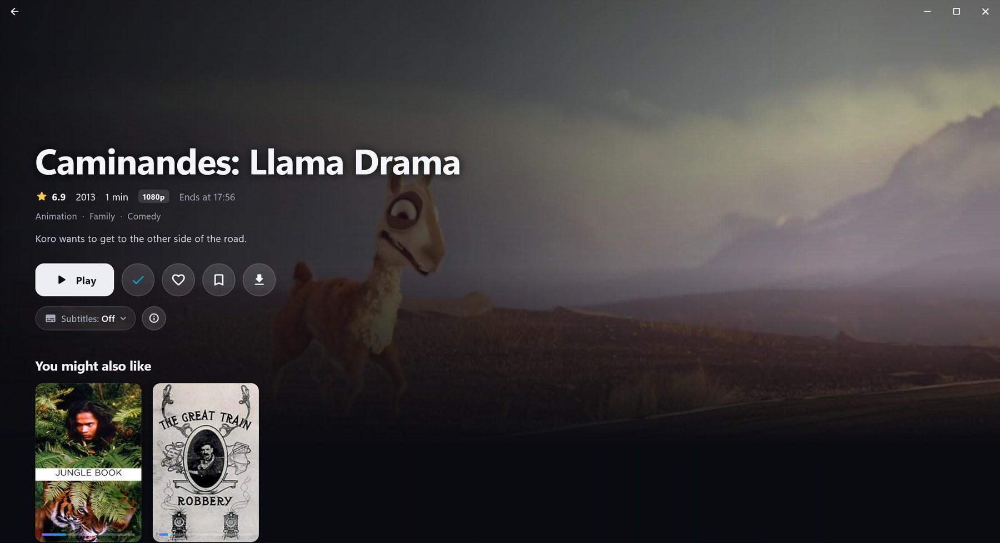
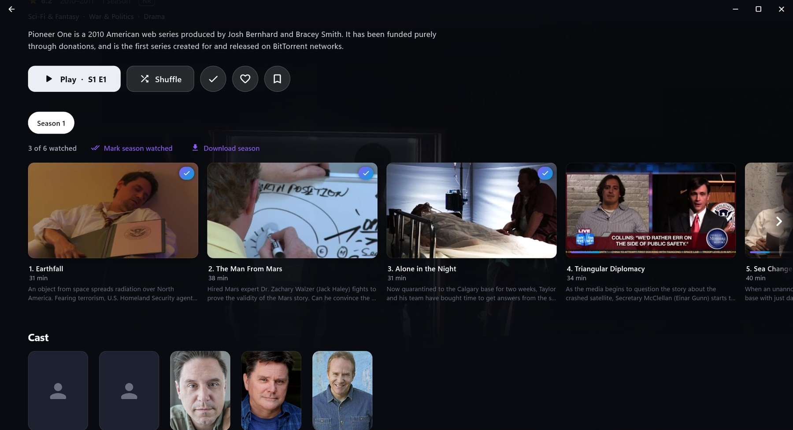
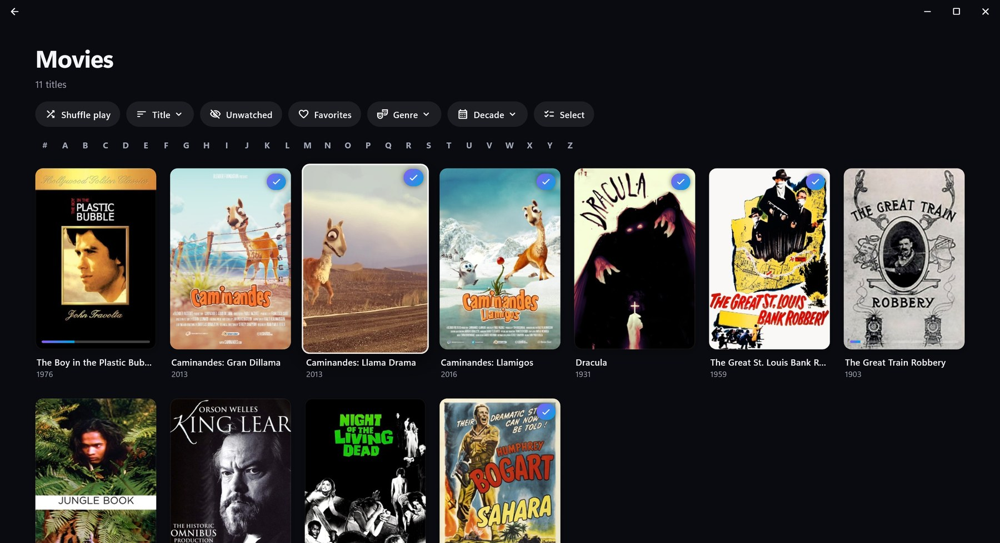
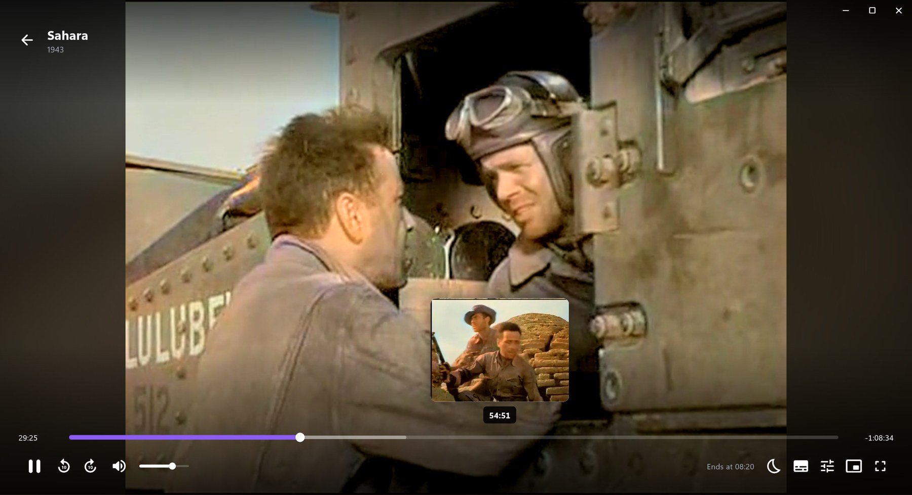
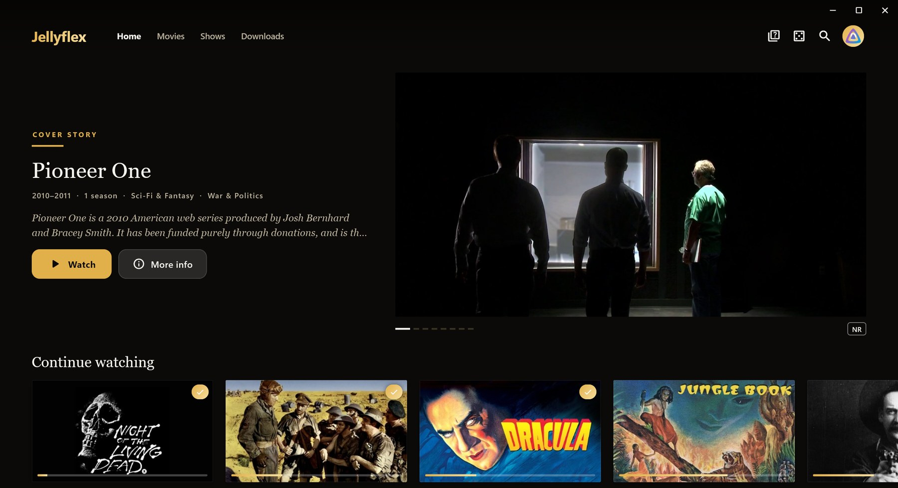
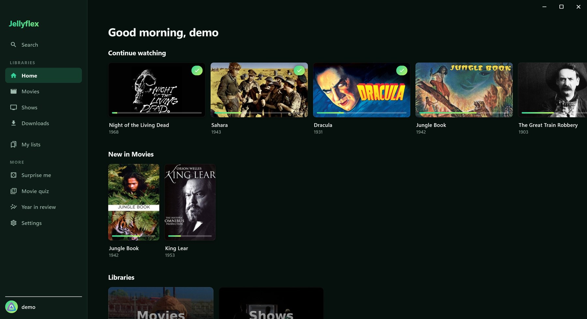
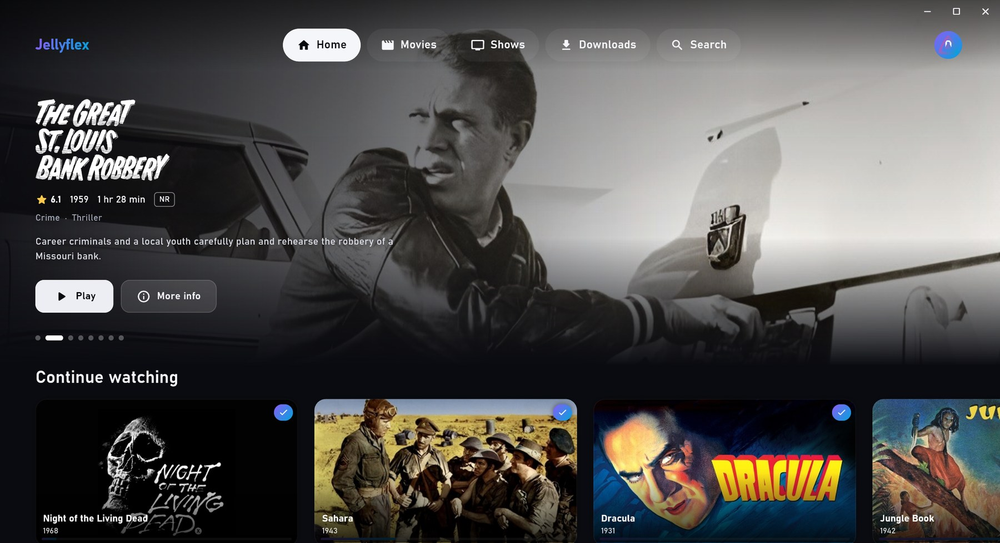
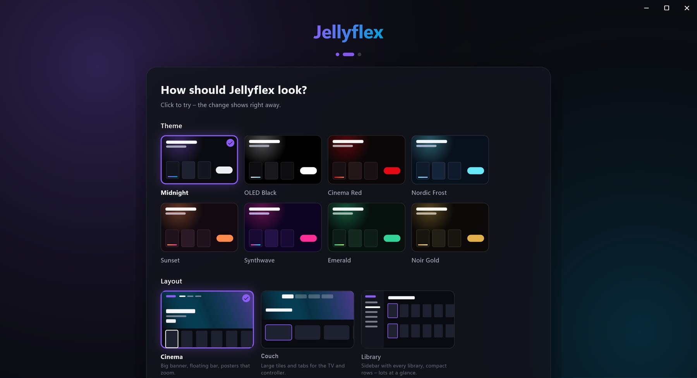

# Jellyflex

A modern, smooth [Jellyfin](https://jellyfin.org) client for Windows and macOS – built with Flutter and
[media_kit](https://github.com/media-kit/media-kit) (mpv). Inspired by Wholphin.

> **Made with Claude.** Jellyflex was written with [Claude Code](https://claude.com/claude-code),
> Anthropic's AI coding assistant; Claude wrote the code, the tests and this README.


| | |
|---|---|
|  |  |
| **Details** – logo, ratings, versions, everything in one place | **Series** – seasons, episodes, shuffle, download a whole season |
|  |  |
| **Library** – filters, A–Z, and a scene preview when you rest on a card | **Player** – Direct Play through mpv, scene previews while seeking |
|  |  |
| **Magazine** layout · Noir Gold theme | **Library** layout · Emerald theme |
|  |  |
| **Couch** layout – large tiles for TV and controller | **First start** – pick language, look and a few options |

<sub>Screenshots: Jellyflex connected to the public [Jellyfin demo server](https://demo.jellyfin.org)
(public-domain and Creative Commons titles).</sub>

## Quick start

**You need:** Windows 10 or 11 (64-bit) or macOS 12 or newer (Apple silicon or Intel), and a
Jellyfin server you can sign in to.

1. Open the [latest release](https://github.com/RED0XI/Jellyflex/releases/latest) and download
   - **Windows:** **`Jellyflex-Setup-<version>.exe`**
   - **macOS:** **`Jellyflex-<version>.dmg`** – *signed Mac downloads are coming; until then,
     [build it yourself](#build-from-source)*

   (The `.sig` files and the `-macOS.zip` are only for the app's own update check.)
2. Install:
   - **Windows:** run the installer. No admin rights needed.
     If Windows shows *"Windows protected your PC"*, click **More info → Run anyway**
     (the installer isn't signed with a paid Microsoft certificate).
   - **macOS:** open the `.dmg` and drag **Jellyflex** into **Applications**. Once Mac releases
     are published they will be signed and notarized by Apple. A version you build yourself is
     not – macOS warns the first time, so right-click the app → **Open**.
3. Start Jellyflex, enter your server address (for example `https://jellyfin.example.com`)
   and sign in – with your password or **Quick Connect**.

That's it. To get new versions automatically offered, turn on
**Settings → About Jellyflex → Look for updates**. Windows and macOS share the same code, so
both get the same features and fixes.
To uninstall: Windows Settings → Apps → Jellyflex, or on macOS drag Jellyflex from
Applications to the Trash.

---

## In detail

### Features

**Watching**
- **Scene preview on cards**: rest on a title and its card flips through scenes (images from your server, no video)
- **Direct Play** of practically every format through mpv (HEVC, AV1, HDR, DTS/TrueHD, ASS/PGS subtitles)
- Audio/subtitle choice from your Jellyfin settings; the language you pick is **remembered per series**
- **Skip intro/recap** (Media Segments, e.g. from the Intro Skipper plugin), **next episode** countdown
- **Trickplay** previews while seeking, **chapters** with pictures (`C`) and a **Scenes** row on the details page
- Quality limit (the server converts on the fly), playback speed, audio/subtitle delay
- Volume is remembered (up to 150 % and with the mouse wheel); resuming starts a few seconds earlier;
  **"Still watching?"** after several episodes in a row; **shuffle play** for series, seasons and libraries
- Progress is reported to the server continuously
- Media overlay and media keys (Windows overlay, macOS Now Playing), **mini player** (`P`),
  **sleep timer**, **Ambilight**

**Browsing**
- Home with rotating banner, Continue watching, Next up, New in …, Favorites – rows can be
  reordered and hidden
- Details pages with backdrop slideshow, logo, ratings, seasons & episodes, cast, similar titles
- **People pages**: photo, biography and everything with that person on your server
- **Versions**: if a movie exists twice (e.g. 4K and 1080p), pick the version; badges show 4K, HDR/Dolby Vision, Atmos
- Library grid with sorting and filters, **multi-select**, smart search (titles, episodes, people)
- **Watchlist and your own lists** – stored as private playlists on your server
- New titles show up **automatically** – no reloading

**Downloads (watch offline)**
- Movies, episodes or whole seasons; pause, resume (also after a restart or crash), cancel right on the details page
- **Choose the folder** (asked on the first download), **only on Wi-Fi/LAN** (no downloads over mobile
  data or phone hotspots), **speed limit**, free-space check
- **Original or smaller version** – for smaller versions you choose the audio track and subtitles
- **Smart downloads**: watched episodes are deleted and the next ones downloaded, with a space limit
- Offline progress is remembered and reported to the server later

**Profiles & personalization**
- Several accounts/profiles, optional **profile PIN** and **lock when away**
- 6 **layouts** (Cinema, Couch, Library, Magazine, Minimal, Retro VHS) and 8 color **themes**
- Your own app name and logo
- Languages: English, German, French, Spanish, Turkish
- Extras: "Surprise me" slot machine, movie quiz, screensaver, seasonal touches, year in review, theme music

### Privacy & security

Jellyflex talks **only to your own Jellyfin server** – no telemetry, no ads, no fonts or images from
other services. Highlights (full list in [SECURITY.md](SECURITY.md)):

- Your login token is stored encrypted (Windows: DPAPI; macOS: AES-256 with the key in your
  Keychain) and removed from logs and error reports.
- HTTPS certificates are checked, also for video streams; plain http only in your home network and with a warning.
- Downloads can't be placed in system folders, and the app only ever deletes its own download folders.
- **Updates:** the update check (off by default) only asks GitHub for the newest version number. When you
  click *Download & install*, the package's **digital signature (Ed25519)** is checked before it runs –
  a modified or damaged file is never started. On macOS the new app's Apple code signature is
  checked as well.

### Keyboard & controller

On macOS, use `⌘` instead of `Ctrl` (`⌘F` search, `⌘,` settings), `⌃⌘F` for fullscreen and
`⌘[` to go back. Continue watching is in the Dock menu (right-click the Jellyflex icon).

| Where | Key | Action |
|---|---|---|
| Everywhere | `Ctrl+F` | Search |
| Everywhere | `Alt+←` / mouse back | Back |
| Everywhere | `F11` | Fullscreen on/off (`Esc` leaves) |
| Everywhere | `?` | All shortcuts |
| Everywhere | `Ctrl+,` | Settings |
| Cards | Right-click | Play, mark watched, add to list, download … |
| Player | `Space` / `K` | Play / pause |
| Player | `←` / `→` (`J` / `L`) | 10 s back / forward |
| Player | `↑` / `↓` | Volume |
| Player | `F` / double-click | Fullscreen |
| Player | `M` | Mute |
| Player | `P` | Mini player |
| Player | `C` | Chapters |
| Player | `I` | Playback info (codec, bitrate, buffer …) |
| Player | `S` | Screenshot to Pictures\Jellyflex |
| Player | `Esc` | Leave mini player/fullscreen, otherwise close |

Without a mouse, the arrow keys move the selection like on a TV, Enter opens, and the menu key
(or Shift+F10) opens the context menu.

| Controller (Xbox, PlayStation …) | Outside the player | In the player |
|---|---|---|
| D-pad / left stick | Move selection | ←/→ seek 10 s |
| A | Select | Play / pause |
| B | Back | Close player |
| X | Context menu | Audio & subtitles |
| Y | Search | – |

### Build from source

You need the [Flutter SDK](https://docs.flutter.dev/get-started/install) and
- **Windows:** Visual Studio 2022 Build Tools ("Desktop development with C++")
- **macOS:** Xcode and CocoaPods (`brew install --cask flutter && brew install cocoapods`)

```bash
flutter run -d windows                 # run in debug mode (Windows)
flutter run -d macos                   # run in debug mode (macOS)
flutter build windows --release        # build → build\windows\x64\runner\Release\
flutter build macos --release          # build → build/macos/Build/Products/Release/Jellyflex.app
```

**macOS packages** (`.dmg` for downloading, `-macOS.zip` + `.sig` for the in-app update):

```bash
tool/build_macos.sh
```

**Installer** (needs [Inno Setup 6](https://jrsoftware.org/isinfo.php)): creates
`dist\Jellyflex-Setup-<version>.exe` and, if a signing key exists, its `.sig` signature:

```bash
powershell -ExecutionPolicy Bypass -File tool/build_installer.ps1
```

### Try it without a real server

A small demo server with made-up movies and series:

```bash
dart run tool/mock_server.dart
```

Enter `http://localhost:8097` in the app, any user name and password. As video for all titles it
uses `%TEMP%\jellyflex_test.mkv` (macOS: `$TMPDIR/jellyflex_test.mkv`) – any video file with two
audio and two subtitle tracks, see `lib/dev/player_harness.dart`. `tool/make_test_video.sh` creates
one with ffmpeg.

### Tests

```bash
flutter test                                                   # fast tests
flutter test integration_test/downloads_test.dart -d windows   # one app test (needs the demo server)
flutter test integration_test/downloads_test.dart -d macos     # the same on macOS
powershell -ExecutionPolicy Bypass -File tool/run_all_tests.ps1  # everything, with a summary
```

Run app tests one file at a time – several files in one run fail on Windows.
Screenshots end up in `build/screenshots/`. The README pictures come from
`integration_test/readme_shots_test.dart` (against a real server, see the comment at the top) and
`python tool/readme_shots.py`.

### Publishing a release (maintainers)

Windows and macOS are released together by GitHub Actions (`.github/workflows/release.yml`):

1. Raise the version in `pubspec.yaml` and `lib/core/version.dart`, commit and push.
2. Tag and push: `git tag v<version> && git push origin v<version>`.
3. The workflow tests and builds both versions, signs the update packages (Ed25519), signs and
   notarizes the Mac app with Apple, and creates the GitHub release with all files:
   `Jellyflex-Setup-<version>.exe` (+ `.sig`), `Jellyflex-<version>.dmg` and
   `Jellyflex-<version>-macOS.zip` (+ `.sig`).

Every push and pull request also builds and tests both systems (`.github/workflows/ci.yml`), so a
change that only works on one of them shows up right away.

**One-time setup** (repository → Settings → Secrets and variables → Actions):

| Secret | What |
|---|---|
| `JELLYFLEX_UPDATE_SIGNING_KEY` | Contents of `update_signing_key.json` (created once with `dart run tool/sign_update.dart --new-key`; on the maintainer's PC under `%APPDATA%\JellyflexRelease`) |
| `MACOS_CERTIFICATE` | "Developer ID Application" certificate exported as `.p12`, base64-encoded (`base64 -i cert.p12 \| pbcopy`) |
| `MACOS_CERTIFICATE_PASSWORD` | Password of that `.p12` |
| `APPLE_ID` | Apple ID of the developer account |
| `APPLE_TEAM_ID` | Team ID (developer.apple.com → Membership) |
| `APPLE_APP_PASSWORD` | App-specific password (appleid.apple.com → Sign-In and Security) |

The secret update key must never be committed. Builds on GitHub run in a neutral folder, so no
personal path ends up in the program. Building by hand still works: `tool/build_release.ps1`
(Windows) and `tool/build_macos.sh` (macOS).

### Project structure

```
lib/
  core/        Server connection, data models, downloads, settings, storage
  core/platform/  Per-system folders and file manager (Windows and macOS)
  features/    Screens: login, home, details, library, search, player, downloads, settings …
  widgets/     Building blocks: cards, rows, buttons, title bar, images, scrolling
  l10n/        All UI texts (English/German in strings.dart, others in strings_fr/es/tr.dart)
windows/       Windows runner (native taskbar, media overlay, network checks)
macos/         macOS runner (Dock menu, Now Playing, Keychain, network checks)
tool/          Demo server, installer/DMG build, update signing, icons
test/          Fast tests · integration_test/  App tests in a real window
```

Images are chosen the same way as in the official Jellyfin web UI (`lib/core/images.dart`).

## License

Jellyflex is free software: you can redistribute it and/or modify it under the terms of the
**GNU General Public License v3.0** – see [LICENSE](LICENSE). Video playback uses libmpv and
FFmpeg under the LGPL-3.0; details for all included components are in
[THIRD_PARTY_NOTICES.md](THIRD_PARTY_NOTICES.md) and in the app under
**Settings → About Jellyflex → Licenses**.
